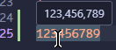
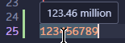
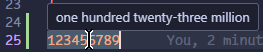
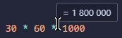
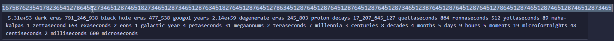

# NumNums

The VS Code extension that makes working with large numbers, expressions, and data formats effortless.

NumNums parses the numbers in your code and instantly displays them in your preferred format via hover tooltips. It features infinite BigInt precision and dynamically calculates magnitudes up to 10^3000.

### Formats numbers on hover

### Evaluates basic math expressions

### Scales to the absolute limits of theoretical math
Whether you need scientific precision or cosmic epochs, NumNums cascades exact measurements infinitely.

### Supported Formats
NumNums supports nearly 20 distinct formatting modes out of the box, including:

* **Math & Scale**: Separated, Scientific, Compact, Fraction, Percentage
* **Developer**: Binary, Hexadecimal, Octal, Base36
* **Data**: Bytes, IEC Bytes (scaling up to 10^162 Geopbytes and Endbytes)
* **Time**: Duration (From Planck time cascading up to the Poincaré Cycle and Heat Death of the Universe)
* **Space**: Length (Metric, Imperial, Astronomical, scaling up to Multiverse Nodes)
* **System & UI**: Datetime (Unix timestamps), File Permissions (chmod), Color (Hex/RGB), Currency
* **Linguistic**: Natural Language, Roman Numerals

### Configuration
NumNums is highly customizable through your VS Code settings. You can configure:

* Display modes to toggle between condensed decimals (`14.2d`) and fully expanded fractions (`14d 4h 48m`).
* Base units for time and length to control how raw numbers are interpreted (e.g., milliseconds vs seconds).
* Custom grouping separators, regional locales, and custom currency codes.
* Shorthand vs full-word unit labels.